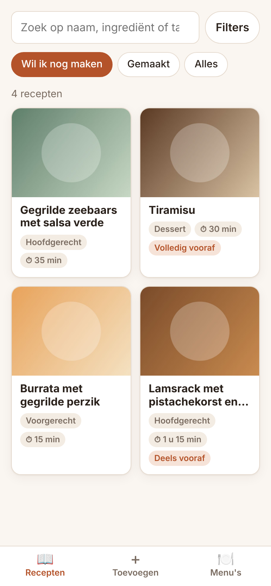
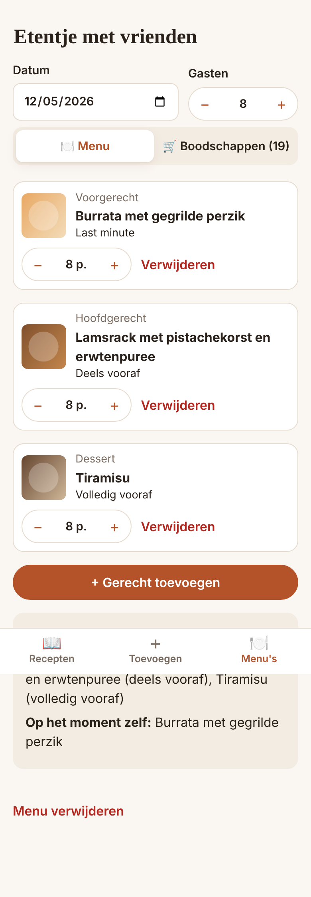
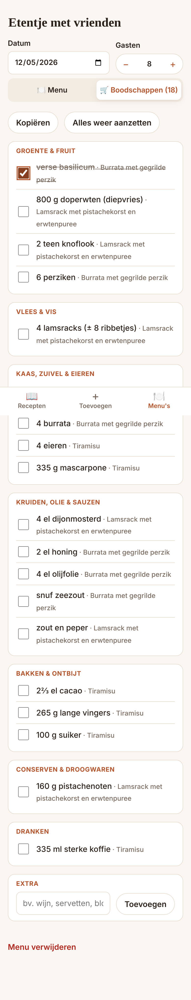

# Videeke 🍲

Een persoonlijke receptenapp om recepten te bewaren die je ooit (echt) wilt maken, vooral voor etentjes.
Werkt op je telefoon en laptop, en kun je op je beginscherm zetten als een app.

<p>  </p>

## Wat kan het?

**Recepten bewaren**
- **Link plakken**: ingrediënten, stappen, foto, tijd en aantal personen worden automatisch ingevuld (werkt op de meeste receptensites).
- **Delen vanuit Instagram of TikTok**: op Android verschijnt Videeke in het deelmenu zodra de app op je beginscherm staat. Op iPhone kopieer je de link en plak je hem. TikTok-captions worden automatisch ingelezen. Instagram blokkeert dat vaak: dan wordt de link bewaard en kun je de caption erbij plakken; Videeke splitst die zelf in ingrediënten en stappen.
- **Foto van een kookboek**: de tekst wordt op je toestel herkend (Nederlands en Engels). Je kijkt hem na en gaat verder.
- **Zelf typen**.

**Terugvinden**
- "Wil ik nog maken" / "Gemaakt" / "Alles"
- Filters op gang, gelegenheid (etentje / doordeweeks), vooraf te maken en tijd
- Zoeken op naam, ingrediënt of tag
- Na het koken: markeer als gemaakt, met eventueel je eigen foto en notities

**Etentje plannen**
- Maak een menu met datum en aantal gasten, kies gerechten uit je recepten
- Hoeveelheden worden automatisch herrekend (ook per gerecht aan te passen)
- Planning: wat kan op voorhand, wat moet last minute
- Eén boodschappenlijst voor het hele menu, samengevoegd en per afdeling van de supermarkt, met vinkjes en extra items. Te delen of te kopiëren.

**Tijdens het koken**: porties aanpassen, stappen afvinken, scherm aan houden.

## Hoe het gebouwd is

- **Frontend**: [Preact](https://preactjs.com) + [Vite](https://vitejs.dev), een installeerbare webapp (PWA)
- **Backend**: [Cloudflare Pages Functions](https://developers.cloudflare.com/pages/functions/) (map `functions/`)
- **Opslag**: [Cloudflare D1](https://developers.cloudflare.com/d1/) (SQLite), ook voor de foto's. De tabellen worden automatisch aangemaakt.
- **Tekstherkenning**: [Tesseract.js](https://tesseract.projectnaptha.com), draait in de browser
- **Login**: één wachtwoord (omgevingsvariabele `APP_PASSWORD`), daarna blijf je een jaar ingelogd

Alles past ruim in het gratis plan van Cloudflare, en je hebt geen creditcard nodig.

```
src/        de app (schermen, stijl)
functions/  de API (/api/...)
server/     gedeelde servercode (database, login, foto's)
shared/     code voor app én server: recepten uit webpagina's halen, ingrediënten schalen, boodschappenlijst
tests/      tests (npm test)
```

## Online zetten (eenmalig, ± 10 minuten)

1. Maak een gratis account op [dash.cloudflare.com](https://dash.cloudflare.com/sign-up).
2. **Database maken**: ga naar *Storage & Databases → D1 SQL Database → Create*. Noem hem `videeke`.
3. **App koppelen aan GitHub**: ga naar *Workers & Pages → Create → Pages → Connect to Git* en kies de repository `Videeke`.
   - Production branch: `main`
   - Framework preset: *None*
   - Build command: `npm run build`
   - Build output directory: `dist`
   - Klik op *Save and Deploy*.
4. **Database en wachtwoord instellen**: open het nieuwe Pages-project → *Settings*:
   - *Bindings → Add → D1 database*: variable name `DB`, database `videeke`.
   - *Variables and Secrets → Add*: type *Secret*, naam `APP_PASSWORD`, waarde een wachtwoord naar keuze.
5. Ga naar *Deployments* en kies bij de laatste deployment *Retry deployment*, zodat de instellingen actief worden.
6. Open `https://<projectnaam>.pages.dev` en log in.

Daarna wordt elke wijziging op `main` automatisch online gezet.

**Op je telefoon zetten**: open de site en kies *Toevoegen aan beginscherm* (iPhone: deelknop in Safari; Android: menu in Chrome → *App installeren*). Op Android verschijnt Videeke dan ook in het deelmenu van Instagram en TikTok.

**Back-up**: in Cloudflare kun je je D1-database exporteren (*D1 → videeke → Backups / Time Travel*), of via `npx wrangler d1 export videeke --remote --output backup.sql`.

## Lokaal ontwikkelen

```bash
npm install
echo "APP_PASSWORD=videeke" > .dev.vars
npm run build && npm run dev:api   # app + API op http://localhost:8788 (lokale database)
npm run dev                         # optioneel: Vite met hot reload op :5173, praat met de API op :8788
npm test
```

## Nog niet ingebouwd (ideeën voor later)

- Video's van Instagram/TikTok automatisch uitschrijven (nu: caption of zelf aanvullen)
- Recepten automatisch vertalen of eenheden omrekenen (cups → gram)
- Wijnsuggesties en een draaiboek per uur voor de avond
- Meerdere gebruikers / delen met anderen
- Volledig offline werken (nu opent de app offline, maar recepten laden vereist internet)
